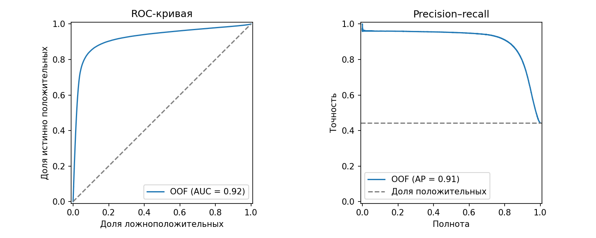

# Удовлетворённость авиапассажиров: baseline и протокол оценки

Исследование предсказания удовлетворённости авиапассажиров на данных [Kaggle Playground Series S6E10](https://www.kaggle.com/competitions/playground-series-s6e10).

[Открыть исследовательский ноутбук](notebooks/01_satisfaction_research.ipynb): анализ данных, обучение baseline, графики и разбор ошибок. Ниже приведены основные результаты и инструкция по запуску.

## Постановка и гипотеза

По характеристикам поездки и оценкам услуг нужно предсказать бинарный ответ об удовлетворённости. Это задача бинарной классификации. Объектом служит строка конкурсного набора; `X` содержит 21 признак пассажира, поездки и услуг. Целевая переменная `y` хранится в столбце `satisfaction` (`True` = 1). Модель присваивает каждой строке скор удовлетворённости, по которому ранжирует объекты. `id` служит идентификатором и исключён из `X`.

**Гипотеза:** логистическая регрессия на этих признаках ранжирует удовлетворённых и неудовлетворённых пассажиров лучше случайного ранжирования, для которого ожидаемый ROC-AUC равен 0,5. Проверка сигнала сама по себе не означает пригодности для применения.

Оценки отдельных услуг могут содержать информацию об итоговом ответе на опрос. Эта связь не доказывает, что оценки услуг вызывают удовлетворённость.

**Сценарий и ограничения.** Полный набор предполагает, что оценки сервисов уже доступны. Они могут быть получены после полёта и в том же опросе, что и целевой ответ; это не прогноз до вылета. Если оценки услуг уже получены, ранжирование могло бы помочь отобрать анкеты с признаками неудовлетворённости для изучения проблем сервиса. Полезность такого применения на реальных данных здесь не проверялась; момент получения каждого признака нужно уточнить. Конкурсные данные синтетические; результаты не подтверждают перенос на реальных пассажиров, будущие периоды или другую авиакомпанию. Строки не обязательно независимы.

## Данные и разведочный анализ

Использован официальный `train.csv`: **699 635 строк**, 21 признак, идентификатор и цель. Положительный класс: 310 339 строк (44,36%), отрицательный: 389 296 (55,64%). 17 признаков числовые или порядковые, 4 категориальные. В `Arrival Delay in Minutes` 292 пропуска; в остальных столбцах пропусков не обнаружено.

В X входят возраст, дальность полёта, 13 оценок сервисов, задержки вылета и прилёта, пол, тип клиента, тип поездки и класс обслуживания. Точный список столбцов задан в [`src/train.py`](src/train.py). Все перечисленные признаки считаются доступными после поездки; реальный момент их получения в данных не подтверждён.

Полных повторов после исключения `id` не найдено. При точном сравнении всех 21 признака совпадающих строк, в том числе с различающимися метками, не обнаружено. Это не проверка близких соседей и не гарантия независимости объектов. Смысл нулей в оценках услуг не установлен; для baseline они сохранены как числовые значения. Возможны шум целевой метки и неопределённость времени появления признаков; по одному названию признака нельзя установить утечку. Описательная статистика рассчитана по всему train. Преобразования при оценке обучаются только внутри каждого обучающего фолда.

SHA-256 использованного `train.csv`: `2313b65c74e6994f01c2628aae82d2f97aa6f74a81950172ff83864837c98b36`.

## Baseline

Для точки отсчёта выбрана логистическая регрессия. Она проста, интерпретируема и работает на CPU. Никакие прогнозы конкурсного ансамбля не используются.

- Числовые и порядковые признаки: медианная импутация и стандартизация.
- Категориальные: наиболее частое значение и one-hot-кодирование; неизвестные категории игнорируются.
- Все преобразования и модель собраны в единый pipeline и обучаются только на train соответствующего фолда.
- `C=1.0`, `solver=lbfgs`, `max_iter=500`; настройки в [конфигурации](configs/baseline.yaml). Зерно разбиения: 42.

Порядковые оценки рассматриваются как числовые: модель предполагает линейный вклад их стандартизованного значения в логит. Это упрощение, которое можно проверить сравнением с нелинейной моделью. Сходимость во всех фолдах достигнута.

## Оценка

Основная метрика в этом исследовании и в соревновании: ROC-AUC. Она показывает долю правильно упорядоченных пар положительного и отрицательного объектов, причём пары с одинаковыми скорами дают половину балла. Метрика оценивает ранжирование без выбора порога. Использован `StratifiedKFold` на 5 фолдов с перемешиванием и seed 42. В каждом фолде pipeline обучается на четырёх пятых данных и делает прогнозы для оставшейся пятой. Каждая строка получает ровно один out-of-fold (OOF) прогноз.

Стратификация сохраняет примерно одинаковую долю классов в фолдах. Такой протокол оценивает случайные разбиения имеющихся данных, но не проверяет перенос во времени или на новые группы: надёжного временного признака и группового идентификатора в наборе нет.

Модель и параметры для этого baseline фиксированы; отбор по leaderboard не проводился. Следующие модели следует сравнивать на тех же фолдах, а не выбирать по публичной доске. Дополнительно приводим average precision (AP, сводная метрика precision–recall) и матрицу ошибок при пороге 0,5; порог выбран для описания, калибровка модели не проверялась.

| Фолд | ROC-AUC | Average precision |
|---:|---:|---:|
| 1 | 0,922417 | 0,910068 |
| 2 | 0,921417 | 0,908925 |
| 3 | 0,921403 | 0,909723 |
| 4 | 0,921274 | 0,907459 |
| 5 | 0,921264 | 0,908696 |
| **Среднее ROC-AUC ± стандартное отклонение по фолдам** | **0,921555 ± 0,000436** | |

Стандартное отклонение описывает разброс пяти фолдов и не даёт доверительного интервала: обучающие выборки пересекаются. ROC-AUC по объединённым OOF-предсказаниям: **0,921556**, AP: **0,908968**. Общий OOF ROC-AUC включает сравнения скоров между фолдами и поэтому не тождественен среднему фолдовых значений.

Для общего OOF ROC-AUC рассчитан **95%-й bootstrap-интервал [0,920844; 0,922291]**. В каждом из 1 000 повторов строки с положительными и отрицательными метками независимо выбирались с возвращением внутри своего класса; число строк каждого класса сохранялось. Границы получены по 2,5-му и 97,5-му процентилям, `seed=20261108`. Подробные параметры и результат сохранены в [bootstrap.json](reports/bootstrap.json).

Интервал описывает разброс метрики при пересэмплировании имеющихся строк с фиксированными OOF-прогнозами, при предположении независимости строк внутри классов. Он относится к объединённому OOF ROC-AUC, а не к среднему по фолдам. Предобработка и модели повторно не обучались; интервал не учитывает разброс обучения, зависимость наблюдений и последствия предыдущего выбора решений. Независимость строк не подтверждена, а перенос на другие данные этой оценкой не проверяется. Из-за конечного числа повторов сами границы немного зависят от seed.

При пороге 0,5 матрица ошибок имеет вид:

| Фактический класс | Прогноз 0 | Прогноз 1 |
|---|---:|---:|
| 0 | 351 511 | 37 785 |
| 1 | 47 335 | 263 004 |



На ROC-графике пунктир показывает случайное ранжирование, на графике precision–recall он обозначает долю положительного класса. Графики и метрики описывают один набор разбиений, а не будущий период.

## Ошибки и срезы

При пороге 0,5 модель ошиблась в 85 120 из 699 635 строк. Первые два примера выбраны по медианному скору среди ошибок соответствующего типа; третий пример выбран как наиболее уверенная ложноотрицательная ошибка. Эти примеры иллюстрируют ошибки; они не представляют их полное разнообразие. В таблице приведены OOF-скоры; их калибровка не проверялась.

| ID | Факт | Скор | Описание |
|---:|---|---:|---|
| 31123 | Не удовлетворён | 0,7069 | Ложноположительный: бизнес-класс, деловая поездка, оценки Wi-Fi и кресла равны 3, развлечений: 4. |
| 556049 | Удовлетворён | 0,2031 | Ложноотрицательный: экономкласс, деловая поездка, оценка Wi-Fi равна 4, кресла: 1, развлечений: 5. |
| 369131 | Удовлетворён | 0,000052 | Ложноотрицательный: экономкласс, деловая поездка, оценки Wi-Fi и кресла равны 1, развлечений: 2. |

По этим примерам нельзя установить, почему клиент дал итоговый ответ или ошибочна ли метка. Модель учитывает все признаки; в таблице показана лишь их часть. Все представленные значения доступны в [таблице примеров](reports/error_examples.csv).

При анализе по типу поездки OOF ROC-AUC составил **0,9198** для деловых поездок (497 441 строка) и **0,6518** для личных (202 194 строки). Доли положительных ответов в группах: 58,43% и 9,73%. Метрики срезов также включают сравнения скоров между фолдами. Мы уже использовали эти данные раньше, а состав групп различается. Поэтому сравнение описывает результат, но не объясняет его причину. [Результаты срезов](reports/slices.csv).

## Выводы и следующие вопросы

Baseline превосходит ориентир случайного ранжирования на выбранной локальной оценке; гипотеза поддерживается для этих разбиений. При этом у модели есть уверенные ошибки и заметно разное качество по срезам. ROC-AUC не доказывает устойчивость к смене распределения или пригодность для реальной авиакомпании.

1. Будет ли ROC-AUC одной модели LightGBM с заранее заданными настройками выше, чем у логистической регрессии на тех же фолдах, и как изменится время обучения? Сравнивать парные разницы по фолдам.
2. Как изменится ROC-AUC логистической регрессии при исключении всех 13 оценок сервисов и сохранении возраста, дальности полёта, двух задержек и четырёх категориальных признаков? Сравнить варианты на тех же фолдах. Эта абляция проверит зависимость модели от доступной информации, а не причинное влияние услуг.
3. Сохранится ли знак разницы ROC-AUC этих фиксированных моделей при seeds 42, 13 и 73 и что изменится в срезах по типу поездки и классу? Сравнить парные фолдовые метрики; устойчивость оценить описательно.

Предыдущий конкурсный поиск уже использовал этот набор, поэтому новый seed не делает проверку полностью независимой от истории выбора. Дополнительные исследования нужно фиксировать до просмотра соответствующих результатов и не считать повторные разбиения независимыми датасетами.

## Запуск

Нужны Python 3.12 и CPU. Файл `data/train.csv` включён в репозиторий; аккаунт Kaggle и отдельная загрузка данных для запуска не нужны. Создайте виртуальное окружение и установите зависимости:

```bash
python3.12 -m venv .venv
source .venv/bin/activate
pip install -r requirements.txt
```

Запустите обучение и проверку метрик из корня проекта:

```bash
./scripts/run_baseline.sh
python -m src.evaluate outputs/baseline/oof.csv
python -m src.bootstrap outputs/baseline/oof.csv --output outputs/baseline/bootstrap.json
```

По умолчанию используется `data/train.csv`. Если файл находится в другом месте, укажите путь с помощью `./scripts/run_baseline.sh --data /path/to/train.csv`. В `outputs/baseline/` создаются OOF-прогнозы, метрики, срезы, примеры ошибок и график. Файл `data/train.csv` включён в Git; остальные данные и каталог `outputs/` исключены. [Зафиксированные метрики](reports/metrics.json) и график относятся к описанному полному прогону. Время запуска зависит от оборудования; сохранённые метрики содержат время одного прогона без учёта импорта библиотек и построения графиков. При указанных версиях SciPy и scikit-learn может появиться предупреждение об игнорируемой опции `iprint`; прогон завершается, а сходимость контролируется отдельно.

Bootstrap использует 1 000 повторов по умолчанию; их число и seed можно задать через `--repetitions` и `--seed`. В `metrics.json` записаны фактические имена входного файла и выходного каталога, хеш данных и экспериментальные настройки. Полные локальные пути не сохраняются. В таблице срезов указан порог, при котором рассчитана доля ошибок.

### Запуск ноутбука

Установите дополнительные зависимости в том же виртуальном окружении и запустите Jupyter из корня проекта:

```bash
pip install -r requirements-notebook.txt
jupyter lab
```

Откройте `notebooks/01_satisfaction_research.ipynb` и выполните ячейки по порядку. Ноутбук читает включённый в репозиторий файл `data/train.csv`; альтернативный путь можно задать переменной окружения `S6E10_DATA` до запуска Jupyter. Ноутбук повторно обучает модель и сохраняет результаты в `outputs/notebook/`. Его текст относится к конфигурации baseline из репозитория; для новых экспериментов используйте отдельную конфигурацию и скриптовый запуск.

## Источники и вклад

- [Predicting Airline Satisfaction, Kaggle / Google LLC](https://www.kaggle.com/competitions/playground-series-s6e10): источник конкурсного `train.csv`, постановки и метрики. На странице соревнования для данных указана лицензия [CC BY 4.0](https://creativecommons.org/licenses/by/4.0/). В репозитории опубликован исходный тренировочный файл без изменений.
- Исследовательские вопросы основаны на предыдущей работе с этими данными. Pipeline логистической регрессии и его оценка разработаны для этого исследования. Готовые прогнозы и код других участников не используются. Зависимости перечислены в `requirements.txt`.
